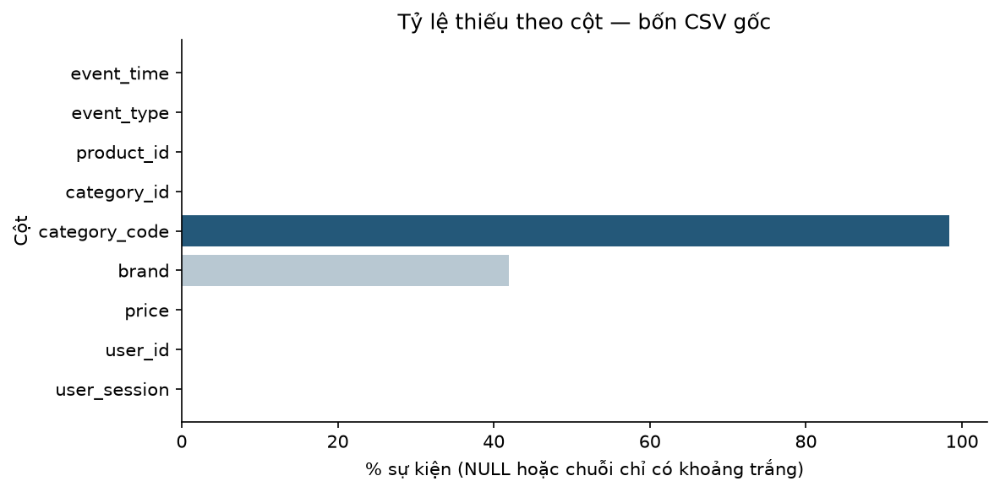
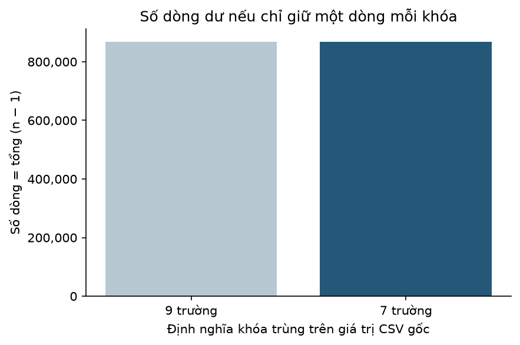

# Báo cáo bài tập lớn — Phân khúc khách hàng bằng RFM và Engagement

**Cập nhật 13/11/2026. P2-T2 PASS; P2-T3 READY FOR STUDENT REVIEW.** Đây là bản trình bày chính gồm năm phần, hướng tới khoảng năm trang Word ở Phase 7; chưa xuất Word. Chi tiết nghiên cứu đã nghiệm thu được giữ nguyên trong mục thu gọn cuối tệp. Chưa có kết quả mô hình hoặc chiến dịch.

## 1. Bài toán, mục tiêu và dữ liệu

Nhóm nghiên cứu cải thiện phân khúc khách hàng mỹ phẩm bằng K-Means thông qua đặc trưng mua hàng và tương tác website. Trình tự là xây F0 cơ sở → ghi hạn chế có bằng chứng → đề xuất → kiểm chứng F1 → đánh giá → hỗ trợ marketing. Chưa mặc định F1 tốt hơn.

Giữ ba câu hỏi đã nghiệm thu:

- RQ1: Dữ liệu REES46 cho thấy những đặc điểm gì về hành vi mua hàng và tương tác website?
- RQ2: Bổ sung Engagement vào RFM có giúp phân biệt những hành vi khách hàng mà RFM truyền thống chưa thể hiện rõ không?
- RQ3: Các phân khúc khách hàng có đặc điểm gì và có thể gợi ý những định hướng marketing nào?

P2-T2 dùng bốn CSV REES46 Cosmetics tháng 10/11/12/2019 và 01/2020: **16.536.158 sự kiện**, mỗi dòng là một event. Toàn bộ thời gian parse được, có UTC và nằm trong `[2019-10-01,2020-02-01)`; không có dòng sai tháng nguồn. February không được đọc. Nguồn Kaggle được cấu hình dự án cũ khai báo; nguồn tải, currency và quyền chia sẻ chưa xác minh đầy đủ.

## 2. Chất lượng dữ liệu và chính sách chuẩn bị

Nhóm đọc toàn bộ bốn tệp bằng DuckDB, giữ trường nguồn dạng văn bản và kiểm tra giá/thời gian bằng biểu thức chẩn đoán. Không bỏ hàng parse lỗi; không điền thiếu hoặc tạo dữ liệu sạch. Missing là NULL hoặc chuỗi chỉ có khoảng trắng. Bảng chi tiết có mẫu số theo cột, tháng và loại event; cách đọc CSV theo [tài liệu DuckDB](https://duckdb.org/docs/2.0/data/csv/overview.html).

| Vấn đề | Số event/dòng | Tỷ lệ trong nhóm | Ảnh hưởng cần xem xét |
|---|---:|---:|---|
| Thiếu brand | 6.931.209 | 41,9155% | Diễn giải thương hiệu; không phải đầu vào 5D |
| Thiếu category_code | 16.259.749 | 98,3285% | Chưa xác minh phân cấp danh mục |
| Thiếu user_session | 3.543 | 0,0214% | Frequency và Sessions 30d; chưa mặc định loại Views |
| Purchase có giá thiếu/lỗi/không dương | 92 | 0,0088% | Buyer, Recency, Frequency và Monetary có thể đổi |
| Dòng dư theo 9 trường | 868.808 | 5,2540% | Views và Monetary có thể tăng khi lặp event |
| Dòng dư theo 7 trường | 868.808 | 5,2540% | Views và Monetary có thể tăng khi lặp event |
| Timestamp ngoài observation | 0 | 0,0000% | Recency và cửa sổ Sessions/Views 30d |

Mẫu số là toàn bộ 16.536.158 event, riêng dòng purchase dùng 1.045.014 purchase events. Đây không phải số đơn hàng. Có 7.704.235 view, 4.619.639 cart và 3.167.270 remove_from_cart; không diễn giải các số này thành funnel hoặc tỷ lệ chuyển đổi.

Category_code thiếu 98,33%, brand thiếu 41,92%, cản trở diễn giải danh mục/thương hiệu nhưng không trực tiếp là hai biến đầu vào MVP. Thiếu session chỉ 0,0214% vẫn cần chú ý; không có purchase thiếu session trong bộ raw này, nên không suy ra 3.543 lượt mua hoặc khách bị mất.

Hai khóa đều có 826.259 nhóm lặp, 1.695.067 dòng nằm trong nhóm và 868.808 dòng dư nếu chỉ giữ một. Khóa 7 bỏ brand/category_code, các trường còn lại giống khóa 9. Kết quả bằng nhau **trên bốn CSV và phép so văn bản hiện tại**, chưa tự chốt chính sách hoặc suy tương đương ETL cũ sau ép kiểu. Không có event_id nên chưa biết mọi trường hợp lặp có phải lỗi kỹ thuật.

Các dòng dư gồm 470 view và 793 purchase; tổng price dương trên phần purchase dư khoảng 3.194,81 đơn vị giá nếu giữ một dòng/khóa. Đây là kịch bản đo ảnh hưởng, chưa xóa dữ liệu. Cả 191 token session được nhiều user dùng chung ảnh hưởng 1.389 event, nên cần khóa user-session.

Toàn bộ có 94 giá âm và 32.903 giá bằng 0; riêng purchase là 91 giá âm và 1 giá 0. Không thấy giá thiếu/không parse được/không hữu hạn hoặc user_id thiếu/sai định dạng. Giá hữu hạn từ −79,37 đến 327,78. Trên purchase dương, Q1=1,59, Q3=5,40; ngưỡng tham khảo Q3+3IQR=16,83 gắn cờ 36.107 event (3,4555%). Giá cao chưa phải lỗi và không tự loại. Phân phối price cùng biểu đồ loại event được trình bày trong notebook, không đưa mọi hình vào bản chính.

Hash SHA256 toàn tháng 12 giống nhau trước/sau lần chạy, metadata bốn tệp không đổi. Điều này xác nhận ổn định bản local, chưa xác thực nhà cung cấp. P2-T2 đã được sinh viên nghiệm thu; P2-T3 đề nghị chính sách sau:

| Chính sách | Lý do và tác động |
|---|---|
| Dedup đủ chín giá trị văn bản trước ép kiểu | Giữ product/category trong khóa; một dòng/nhóm. Giảm giá mua và view bị lặp, giữ số phiên riêng biệt. Thiếu event_id nên đây là giả định nghiên cứu. |
| Bỏ brand/category_code; product/category chỉ bỏ ở bước cuối | Năm biến không cần chúng. Không bỏ event vì thiếu brand/category; không DISTINCT lại trên năm cột. |
| User hợp lệ, timestamp có timezone trong observation UTC | Không gán khách/thời gian giả; biên event xác định R và cửa sổ Engagement. |
| Purchase hợp lệ: giá dương và có phiên | Dùng chung cho R/F/M. Giữ event giá không hợp lệ để xét tương tác; không tự cắt giá cao hoặc suy giá âm là hoàn tiền. |
| Session thiếu/sai dạng thành NULL | Không tạo phiên giả; vẫn giữ view hợp lệ. Phiên dùng khóa user-session, không chỉ token. |
| Price DECIMAL(18,2), R giữ phần lẻ | Guard giá nguồn trước cast; không round sớm. Số đếm giữ nguyên, chỉ làm tròn khi hiển thị. |

Lần kiểm chứng toàn dữ liệu trong database tạm còn **15.667.350 event**, loại **868.808 bản dư**; không có hàng bị loại bởi user/time/loại event. Output dự kiến chỉ có event_time, event_type, user_id, user_session, price. Nếu DISTINCT lần nữa sau projection sẽ mất thêm **363.403 dòng khác nhau trên khóa nguồn**, nên không làm bước đó.

Sau dedup còn 88 purchase giá không dương và 3.179 event thiếu session; giữ các event này nhưng áp điều kiện riêng khi tính. Tổng price mua hợp lệ giảm từ 5.144.461,71 xuống 5.141.266,90; Views 30d từ 1.997.977 xuống 1.997.872, gồm tám view thiếu session vẫn giữ. Số buyers hợp lệ 92.652, phiên mua 126.503 và phiên 30d trên toàn users 947.209 không đổi bởi dedup. Điều kiện purchase hợp lệ không làm đổi lần mua cuối hoặc loại toàn bộ lịch sử mua của user nào trong lần kiểm tra này; không suy luôn đúng cho mọi dữ liệu. Đây là đối chiếu chính sách, chưa phải bảng feature theo từng khách hoặc Parquet chính thức.

## 3. Đặc trưng và phương pháp dự kiến

Chưa tính lại bảng đặc trưng. Với cutoff T=01/02/2020 UTC, dự kiến:

| Biến | Định nghĩa | Giới hạn |
|---|---|---|
| Recency | Số ngày từ purchase hợp lệ cuối đến T | Chỉ buyers theo điều kiện purchase đề nghị ở P2-T3 |
| Frequency | Số khóa user-session khác nhau có purchase hợp lệ | Proxy phiên mua, không phải số đơn |
| Monetary | Tổng price purchase hợp lệ | Không phải net GMV; currency/refunds chưa xác minh |
| Sessions 30d | Số phiên trong `[02/01/2020,T)` | Phụ thuộc session và điều kiện event |
| Views 30d | Số view events trong cùng cửa sổ | Không phải số sản phẩm duy nhất hoặc ý định mua |

F0 dùng R/F/M; F1 thêm Sessions/Views. Non-buyers mô tả riêng, không gán Recency giả. Phase 3 xem phân phối, Phase 4 chốt cách tính/biến đổi theo dữ liệu; chưa khẳng định log/scaling có lợi hoặc thêm biến/thuật toán ngoài phạm vi.

## 4. Kiểm chứng cải tiến — chưa thực nghiệm

Giữ H1: Engagement có thể phân biệt hành vi khi lịch sử mua tương tự; H2: tiền xử lý phù hợp có thể giúp trong cùng bộ biến; H3: hồ sơ rõ có thể hỗ trợ gợi ý marketing. Phase 5 phải ghi hạn chế F0 trước F1, giữ cùng buyers/cutoff/policy, thử K=2–6 và nhiều seed. Khi đo tác động log/scaling, chỉ đổi bước cần kiểm tra trong cùng bộ biến. Scaler fit riêng F0/F1, cùng quy tắc cho RFM chung.

Đánh giá Silhouette, DBI, ổn định, cỡ cụm, hồ sơ cả năm biến ở đơn vị gốc, thông tin hành vi và tài nguyên. Không dùng riêng Silhouette giữa hai không gian để kết luận F1 thắng; chấp nhận giữ F0 nếu chưa có lợi ích rõ. Chưa có K cuối, nhãn, chỉ số hoặc biểu đồ so sánh mô hình mới.

## 5. Ứng dụng dự kiến và hạn chế

Phase 6 trình bày **Cụm → đặc điểm quan sát → mục tiêu → hành động gợi ý → căn cứ → KPI → hạn chế**, ghi Research Demo / REES46. Chưa đặt tên cụm hoặc chứng minh gợi ý tăng doanh thu/chuyển đổi; không gửi chiến dịch tự động.

Chính sách P2-T3 còn chờ sinh viên nghiệm thu. Trùng giá trị không tự là lỗi; price dương chưa chứng minh giao dịch hoàn tất, price âm/cao chưa rõ bối cảnh; hash local không chứng minh nguồn. Giữ giới hạn nguồn tải/currency/quantity/refunds và các vấn đề môi trường. February đã được xem ở dự án cũ, không phải untouched holdout và không dùng chọn mô hình. Chưa xác nhận lần chạy mới trên Colab hoặc toàn bộ môi trường. Dừng READY FOR STUDENT REVIEW của P2-T3; chưa tạo observation Parquet P2-T4.

**Nguồn và kết quả:** [REES46 Cosmetics được cấu hình cũ khai báo](https://www.kaggle.com/datasets/mkechinov/ecommerce-events-history-in-cosmetics-shop); [bảng tổng hợp](../results/p2_t2/quality_summary.csv), [chi tiết theo nhóm](../results/p2_t2/quality_details.csv); [đối chiếu chính sách](../results/p2_t3/stage_summary.csv), [số dòng và lý do](../results/p2_t3/policy_counts.csv); giải thích và giới hạn trong LEARNING_GUIDE phần 18–19. Kiểu DECIMAL và projection theo [DuckDB Numeric](https://duckdb.org/docs/2.0/sql/data_types/numeric.html) và [Parquet](https://duckdb.org/docs/2.0/data/parquet/overview.html). Tài liệu RFM/RFM-B và thiết kế đã nghiệm thu được giữ bên dưới.

Chi tiết nghiên cứu đã nghiệm thu trước P2-T2 — giữ nguyên nội dung để tham khảo

# Báo cáo bài tập lớn — Phân khúc khách hàng bằng RFM và Engagement

**Cập nhật:** 13/11/2026. Phase 1 và P2-T1 đã được nhóm nghiệm thu; P2-T1 chỉ kiểm tra header/mẫu giới hạn đủ bốn tháng. Chưa có thí nghiệm F0/F1. Nhật ký thực hiện và nghiệm thu được ghi riêng trong `PROGRESS.md`.

## 1. Giới thiệu và thiết kế nghiên cứu — P1-T1

### 1.1. Giới thiệu đề tài

Khách hàng của một website mỹ phẩm có thể khác nhau về thời điểm mua, số lần mua, mức chi tiêu và việc quay lại xem sản phẩm. Nếu chỉ nhìn tổng doanh thu hoặc coi mọi người giống nhau, doanh nghiệp có thể bỏ qua những nhu cầu khác nhau và khó giải thích vì sao cần một hướng chăm sóc khách hàng cụ thể.

Phân khúc khách hàng là chia khách thành các nhóm có đặc điểm tương đồng theo tiêu chí đã chọn. Nhóm nghiên cứu cách phân khúc từ REES46 Cosmetics bằng K-Means — phương pháp gom các điểm dữ liệu gần nhau. Đây là nghiên cứu mô tả hành vi, chưa phải mô hình dự đoán một người sẽ mua hàng hay đánh giá hiệu quả chiến dịch.

### 1.2. Lý do chọn đề tài

Nhóm lựa chọn đề tài này vì dữ liệu mua hàng và dữ liệu tương tác phản ánh những khía cạnh khác nhau. Trong tình huống minh họa, khách A mua thường xuyên và chi tiêu nhiều; khách B từng mua nhưng đã lâu không quay lại; khách C mua ít nhưng vẫn truy cập và xem sản phẩm. Một thông điệp chung cho cả ba có thể chưa phù hợp với nhu cầu của từng người. Phân khúc giúp mô tả các khác biệt trước khi đặt giả thuyết về cách tiếp cận; không chứng minh thông điệp nào đã hiệu quả.

RFM tóm tắt lịch sử mua qua Recency — thời gian từ lần mua gần nhất, Frequency — tần suất mua và Monetary — tổng giá trị mua. Các thành phần này được giới thiệu trong [tài liệu RFM của IBM](https://www.ibm.com/docs/en/watsonx/w-and-w/2.4.x?topic=properties-rfmanalysisnode). Trong REES46 không có order_id, nên nhóm đo Frequency bằng số phiên có mua duy nhất theo khóa `(user_id, session_id)`, không gọi đó là số đơn hàng. Monetary là tổng giá purchase hợp lệ, chưa phải doanh thu ròng.

RFM chưa mô tả trực tiếp việc quay lại website mà chưa mua. Hai người có lịch sử mua giống nhau vẫn có thể khác số phiên truy cập và lượt xem gần đây. Vì vậy, nhóm đề xuất nghiên cứu thêm `sessions_30d` và `views_30d`, gọi chung là Engagement — mức độ tương tác website. Đây là lý do để kiểm tra, chưa phải kết luận hai biến chắc chắn làm phân cụm tốt hơn.

### 1.3. Mục tiêu nghiên cứu

Mục tiêu của nhóm là nghiên cứu cải thiện khả năng phân khúc khách hàng bằng K-Means thông qua lựa chọn đặc trưng, tiền xử lý phù hợp và bổ sung thông tin tương tác website, từ đó hỗ trợ ra quyết định marketing. So sánh là cách kiểm chứng đề xuất cải tiến. Cụ thể:

- Mô tả hành vi mua hàng và tương tác trong khoảng thời gian nghiên cứu.
- Xây dựng F0 gồm R, F, M làm cơ sở; ghi hạn chế quan sát được, đề xuất thay đổi có lý do rồi kiểm chứng F1 thêm sessions_30d, views_30d trên cùng tập buyers — khách mua đủ điều kiện.
- Kiểm tra tác động của một thay đổi tiền xử lý nếu có căn cứ, trong cùng bộ đặc trưng và giữ các điều kiện khác cố định.
- Diễn giải đặc điểm các phân khúc và đề xuất hướng marketing có căn cứ mô tả, kèm giới hạn và nhu cầu thử nghiệm tiếp.

### 1.4. Câu hỏi nghiên cứu

Để tìm hiểu vấn đề trên, nhóm đặt ra:

- **RQ1:** Dữ liệu REES46 cho thấy những đặc điểm gì về hành vi mua hàng và tương tác website?
- **RQ2:** Bổ sung Engagement vào RFM có giúp phân biệt những hành vi khách hàng mà RFM truyền thống chưa thể hiện rõ không?
- **RQ3:** Các phân khúc khách hàng có đặc điểm gì và có thể gợi ý những định hướng marketing nào?

### 1.5. Phạm vi nghiên cứu

Nhóm chỉ dùng REES46 Cosmetics. Khoảng quan sát dự kiến là `[2019-10-01, 2020-02-01)`; cửa sổ tương tác gần đây là `[2020-01-02, 2020-02-01)`, theo quy ước UTC đang chờ kiểm tra lại ở Phase 2. Mỗi bảng đặc trưng có một dòng/khách hàng; dữ liệu sự kiện được tổng hợp trước mốc chốt, kể cả khi session kéo dài qua mốc này.

Chỉ buyers có RFM hợp lệ được đưa vào so sánh F0/F1. Non-buyers được mô tả riêng về tương tác, không gán Recency giả. Cách loại trùng, buyer, price, session và rounding vẫn chờ chốt ở Phase 2; các bảng cũ chỉ là ứng viên. Không dùng model/scaler/labels/metrics 7D cũ cho nghiên cứu 5D này. February đã được xem nên không phải untouched holdout; không dùng February tạo đặc trưng hoặc chọn mô hình.

P1-T1 chỉ xác định bài toán và cách kiểm chứng. Chưa EDA, xử lý dữ liệu, tạo đặc trưng, chạy K-Means hoặc làm dashboard. Phạm vi toàn dự án nằm trong `PROJECT_PLAN.md`; các vấn đề dữ liệu giữ ở mục 4.5.

### 1.6. Phương pháp nghiên cứu dự kiến

Nhóm dự kiến kiểm tra chất lượng và chốt quy tắc dữ liệu ở Phase 2, mô tả hành vi ở Phase 3, tính năm đặc trưng ở Phase 4, so sánh F0/F1 ở Phase 5 rồi diễn giải ở Phase 6.

Nhóm sẽ dùng K-Means theo trình tự: xây dựng F0 → ghi hạn chế → đề xuất cải tiến → thực nghiệm → đánh giá → hỗ trợ marketing. F0 là baseline — phương án cơ sở để đối chiếu. Kết quả được xem xét bằng chất lượng phân cụm, đặc điểm khách hàng và khả năng giải thích; không mặc định F1 tốt hơn F0. Thiết kế cải tiến P1-T4 nằm trong phần kế hoạch bên dưới, chưa phải kết quả Phase 5.

## 2. Kế hoạch kiểm chứng ba câu hỏi

Đọc bảng từ trái sang phải: câu hỏi cần biết điều gì → phải có dữ liệu nào → dự kiến làm gì → phải lưu kết quả nào → dựa vào đâu để nhận xét. Đây là kế hoạch, chưa phải kết quả phân tích.

| Câu hỏi | Dữ liệu cần dùng | Cách phân tích dự kiến | Kết quả cần có | Cách đánh giá |
|---|---|---|---|---|
| RQ1 — hành vi mua và tương tác | Events trước cutoff: thời gian, loại event, user, session, price; quy tắc hợp lệ đã chốt | Phase 3: thống kê sự kiện, phiên và khách; mô tả phân phối mua/tương tác; tách buyers và non-buyers | Bảng/biểu đồ có đơn vị một dòng, mẫu số và cửa sổ thời gian rõ | Đối chiếu số đếm với nguồn đã chấp nhận; không coi purchase rows là số đơn; giải thích missing/outliers và giới hạn quan sát |
| RQ2 — thông tin bổ sung từ Engagement | Cùng buyers với năm biến hợp lệ; F0 dùng ba biến, F1 dùng năm biến | Phase 5: so sánh F0/F1; xem chỉ số và đặc điểm cụm trên cùng năm biến ở đơn vị gốc | Bảng so sánh cấu hình, Silhouette, Davies–Bouldin, cỡ cụm, đặc điểm cụm, ổn định và tài nguyên | Đúng cohort/cutoff trước; cân nhắc chất lượng, thông tin bổ sung và khả năng giải thích; không xếp hạng chỉ bằng Silhouette; chấp nhận kết quả chưa có bằng chứng F1 tốt hơn |
| RQ3 — diễn giải và gợi ý | Nhãn cụm mới cùng bảng đặc trưng đã chấp nhận; không lấy nhãn 7D cũ | Phase 6: mô tả mỗi nhóm và nối đặc điểm quan sát với hướng tiếp cận dự kiến | Bảng đặc điểm → diễn giải → gợi ý marketing → giới hạn | Mỗi gợi ý phải chỉ được bằng chứng mô tả; không gán xác suất mua, không khẳng định nhân quả hoặc hiệu quả chiến dịch khi chưa thử nghiệm |

## 3. Tài liệu tham khảo liên quan

### 3.1. Dự án RFM truyền thống được tham khảo — P1-T2

Nhóm đọc repository ch1ns0n/Customer-Segmentation tại commit `d4a8a864ef0128708a0cd0a0e2799faf23b9dd60`, gồm [README](https://github.com/ch1ns0n/Customer-Segmentation/blob/d4a8a864ef0128708a0cd0a0e2799faf23b9dd60/README.md), [Customer_Segmentation_Model.ipynb](https://github.com/ch1ns0n/Customer-Segmentation/blob/d4a8a864ef0128708a0cd0a0e2799faf23b9dd60/Customer_Segmentation_Model.ipynb) và [customer_segmentation_app/app.py](https://github.com/ch1ns0n/Customer-Segmentation/blob/d4a8a864ef0128708a0cd0a0e2799faf23b9dd60/customer_segmentation_app/app.py). Mục đích là hiểu cách nối dữ liệu giao dịch với RFM, biến đổi và phân cụm, không sao chép hoặc chạy lại mô hình. Số ô notebook dưới đây đếm từ 1, gồm cả ô Markdown, không phải execution count.

README ghi nguồn Online Retail từ UCI. Theo [mô tả UCI](https://archive.ics.uci.edu/dataset/352/online+retail), đây là giao dịch bán lẻ trực tuyến tại Anh giai đoạn 2010–2011. Tám cột gồm InvoiceNo — mã hóa đơn, StockCode — mã sản phẩm, Description — mô tả, Quantity — số lượng, InvoiceDate — thời điểm, UnitPrice — đơn giá, CustomerID — mã khách và Country — quốc gia. Một dòng thể hiện một mặt hàng trong giao dịch; một hóa đơn có thể có nhiều dòng. UCI mô tả mã InvoiceNo bắt đầu bằng C/c là giao dịch hủy và UnitPrice dùng bảng Anh. Nhóm chỉ đối chiếu mô tả và code, chưa tải/kiểm tra tệp Excel để xác nhận nó trùng bản UCI.

### 3.2. Cách repository tính RFM và phân cụm

| Bước và vị trí | Cách làm trong repository | Điều nhóm cần hiểu |
|---|---|---|
| Chuẩn bị, ô 3–7 | Đọc Excel, bỏ dòng thiếu CustomerID, tạo TotalPrice bằng Quantity × UnitPrice | Thiếu mã khách thì không gom RFM cho đúng người. Phân tích sau khi bỏ dòng chỉ đại diện các khách có ID; tổng giá một dòng khác đơn giá |
| RFM, ô 8 | Mốc tham chiếu là InvoiceDate lớn nhất sau bước bỏ ID thiếu cộng một ngày. Gom theo CustomerID: R lấy chênh lệch với ngày cuối bằng `.days`; F đếm InvoiceNo riêng biệt; M cộng TotalPrice | Một hóa đơn nhiều sản phẩm vẫn chỉ làm F tăng một. Code lấy ngày cuối của các dòng còn lại, chưa tách riêng mua hợp lệ với hủy/hoàn trả |
| Biến đổi, ô 12–15 | Lấy log1p của F và M; sau đó ghi đè Monetary_log: M dương thì lấy log1p, còn lại bằng 0. StandardScaler học trên R, Frequency_log, Monetary_log theo đúng thứ tự này | Log giảm chênh lệch lớn; scaler đưa các biến về thang đo so sánh được. Hai bước có vai trò khác nhau và chưa tự bảo đảm phân cụm tốt |
| Chọn K và phân cụm, ô 16–18 | Vẽ Elbow từ inertia cho K=1–10; sau đó đặt K=4, random_state=42 | Inertia là tổng khoảng cách bình phương tới tâm cụm. README nói K=4 được chọn thủ công theo khả năng diễn giải; không có lệnh tự tìm điểm gãy và không có chứng minh 4 là lựa chọn duy nhất |
| Diễn giải, ô 19–26 | Xem trung bình RFM, boxplot/biểu đồ; vẽ PCA hai chiều; gán tên bằng dictionary theo nhãn 0–3 | PCA được dùng sau khi fit để vẽ, không phải ba biến đầu vào mô hình. Tên cụm do tác giả đặt, không phải thuật toán tự hiểu nghiệp vụ |
| Demo, ô 28 và app.py | Lưu model/scaler; web nhận R/F/M, biến đổi log F/M, dùng scaler đã lưu rồi gán cụm bằng model | `predict` ở đây là gán vào cụm đã học, không phải dự đoán xác suất mua. Nhóm chỉ đọc luồng này, không mở web hoặc nạp pickle |

Tên được gán là Occasional Buyers, Loyal High-Spenders, Dormant Customers và Potential Loyalists. Bảng trung bình đã lưu ở ô 19 phù hợp với cách mô tả tương đối: cụm 1 có F/M cao hơn, cụm 2 có R cao hơn các cụm còn lại. Tuy nhiên, tên “tiềm năng trung thành” chưa xác minh hành vi tương lai. Khi tự nghiên cứu, nhóm cần đọc đặc điểm ở đơn vị gốc trước khi đặt tên; không mang nguyên tên hay số cụm sang REES46.

### 3.3. Những điểm cần thận trọng khi học theo

Các nhận xét dưới đây chỉ dựa trên ba file đã đọc và output được lưu trong notebook gốc, không phải kết quả chạy mới:

- **Hủy/hoàn trả:** trước khi tính RFM, code chỉ bỏ ID thiếu; chưa có bước lọc InvoiceNo dạng C/c hoặc kiểm tra Quantity/UnitPrice. Vì vậy hóa đơn hủy có thể được tính vào F, ngày hủy có thể ảnh hưởng R và giá trị âm có thể đi vào M. Cần xác định ý nghĩa giao dịch trước khi gọi chúng là hành vi mua.
- **Monetary không dương:** ô 12–13 lưu cảnh báo log không hợp lệ và giá trị Monetary_log thiếu. Ô 14 thay toàn bộ M≤0 bằng 0 trên thang log, làm mất phân biệt giữa các mức âm và 0; đây chưa phải chính sách xử lý hoàn trả đã được giải thích. Không chuyển quy tắc này sang MVP khi cleaning policy còn chờ Phase 2.
- **Đánh giá K:** ba file có inertia/Elbow và mô tả cụm, nhưng không có code tính Silhouette, Davies–Bouldin hoặc kiểm tra ổn định qua nhiều seed. Elbow và biểu đồ hai chiều chưa đủ để khẳng định K=4 tốt nhất; không suy ra độ chính xác phân loại hoặc hiệu quả marketing.
- **Nhất quán khi đưa lên web:** notebook dùng quy tắc M dương mới lấy log, còn app.py lấy log1p(M) trực tiếp. M âm có thể cho giá trị khác bước huấn luyện, hoặc không hữu hạn khi M≤−1. Chỉ riêng việc nạp cùng scaler không sửa được khác biệt này. App cũng chưa có kiểm tra miền giá trị nghiệp vụ trước bước log.
- **Giới hạn kiểm chứng:** không chạy notebook, không tải Excel, không nạp model/scaler pickle nên chưa xác nhận các artifact lưu sẵn khớp đúng notebook này. Đường dẫn xuất file Windows riêng ở ô 28 không phù hợp để sao chép sang Colab hoặc máy của nhóm.

### 3.4. So sánh với nghiên cứu REES46 của nhóm

| Nội dung | Repository Online Retail | MVP REES46 |
|---|---|---|
| Nguồn dữ liệu | UCI theo README, bán lẻ trực tuyến 2010–2011; chưa xác minh bản Excel | Cosmetics events 2019–2020; nguồn/điều khoản còn các mục cần xác minh ở Phase 2 |
| Đơn vị một dòng | Dòng mặt hàng trong giao dịch/hóa đơn | Sự kiện website: view, cart, purchase… |
| Mã hóa đơn/đơn hàng | Có InvoiceNo, một hóa đơn có thể nhiều dòng | Không có order_id; không suy mã đơn từ session |
| Frequency | Code đếm InvoiceNo riêng biệt, chưa loại hóa đơn hủy | Số phiên có mua duy nhất theo `(user_id, session_id)`; chính sách hợp lệ vẫn cần chốt |
| Monetary | Cộng Quantity × UnitPrice; code chưa tách hủy/hoàn trả | Cộng price của purchase hợp lệ; không có quantity để tự nhân, không gọi là net GMV |
| Đầu vào K-Means | Ba biến R, log F, log M sau StandardScaler, với quy tắc M≤0 nêu trên | Dự kiến F0: R/F/M; F1 thêm sessions_30d/views_30d; biến đổi cụ thể chờ Phase 4 |
| Đánh giá/trình bày | Inertia/Elbow, thống kê/biểu đồ, tên cụm thủ công và Flask demo | Dự kiến so sánh nhiều tiêu chí ở Phase 5 và giải thích kết quả ở Phase 6; chưa có model/metrics MVP |

Nhóm có thể học cách gom từ dòng giao dịch lên một khách hàng, xem phân phối trước khi biến đổi và đọc đặc điểm cụm trước khi đặt tên. Nhóm không sao chép K=4, quy tắc xử lý giá âm, dictionary tên cụm, đường dẫn xuất model hay Flask. Không so trực tiếp điểm Silhouette hoặc tên cụm giữa hai dự án có dữ liệu, định nghĩa và không gian đặc trưng khác nhau. P1-T2 chỉ giúp hiểu phương pháp; không thay đổi chính sách dữ liệu hoặc hoàn thành thí nghiệm REES46.

### 3.5. Bài nghiên cứu RFM-B — P1-T3

Nhóm đọc *Behavioral Intelligence in Digital Retail: An Extended RFM Framework for Customer Segmentation and Resource Allocation* của Iman Squalli Houssaini và Miloud Daoud, [Preprints.org, bản v1 ngày 13/04/2026](https://www.preprints.org/manuscript/202604.0852/v1), DOI `10.20944/preprints202604.0852.v1`. Trang nguồn ghi bản này chưa qua bình duyệt. Những kết quả bên dưới là tác giả công bố, nhóm chưa tái tạo bằng dữ liệu hoặc code.

Vấn đề nhóm tìm hiểu là cách bổ sung góc nhìn hành vi bên cạnh thời điểm mua, tần suất và tổng chi tiêu. Phạm vi đọc gồm Abstract, Introduction, mục 3, Bảng 2, mục 5–6, mục 8 và Conclusion. Các ví dụ và nhận xét áp dụng dưới đây do nhóm dùng để học, tách riêng với số liệu của bài báo.

### 3.6. Bốn đặc trưng bổ sung và điều cần kiểm tra

Bảng này diễn giải định nghĩa tại **Bảng 2 của bài báo**. Các số trong cột ví dụ chỉ là minh họa, không lấy từ nghiên cứu hoặc REES46 Cosmetics. Các phép đếm đều cần cùng khách, cửa sổ thời gian và điều kiện sự kiện phù hợp; P1-T3 chưa thực hiện phép tính trên dữ liệu thật.

| Đặc trưng và ý nghĩa | Công thức theo Bảng 2 | Dữ liệu cần khi xem xét Cosmetics | Ví dụ minh họa và giới hạn |
|---|---|---|---|
| Conversion Rate (CVR) — mức mua so với mức xem | Số purchase events / số view events của user | user_id, event_type, event_time; kiểm tra điều kiện event và mẫu số | 3/10=0,3; không có nghĩa 30% phiên có mua. Mẫu số 0 thì chưa xác định; tỷ số event không tự bị chặn ở 1 |
| Category Breadth — độ rộng danh mục mua | Số danh mục **cấp cao nhất** khác nhau đã mua | User, purchase, category_id và bản đồ cấp danh mục/category_code đã được xác minh | Ba category_id có thể chỉ thuộc hai nhóm cấp cao. Chưa thể thay định nghĩa này bằng đếm category_id khi chưa biết cấp và missing |
| Average Order Value (AOV) — cách bài đặt tên mức chi bình quân | Monetary / Frequency; F là số phiên có mua riêng biệt | Purchase hợp lệ, price, user, thời gian và khóa user-session; quy tắc M/F đã chốt | 300/2=150 đơn vị giá/**phiên mua**. Không có order_id nên nhóm gọi là Average Spend per Purchase Session — mức chi trung bình mỗi phiên mua, không phải giá trị đơn hàng thật |
| Brand Diversity — độ đa dạng thương hiệu mua | Số thương hiệu khác nhau đã mua | User, purchase, brand, thời gian; kiểm tra missing và cách biểu diễn tên | A, A, B cho hai thương hiệu được quan sát. Brand thiếu không tự trở thành thương hiệu thứ ba; số ít thương hiệu chưa chứng minh lòng trung thành |

**Nhận xét của nhóm:** mục 3.2 có diễn giải CVR bằng ngôn ngữ về phiên, còn Bảng 2 dùng tỷ số event. Hai cách đo không tương đương. Nếu muốn nói tỷ lệ phiên có mua thì phải định nghĩa tử số/mẫu số theo phiên riêng, không đổi tên cho tỷ số event. Tương tự, tên AOV không làm purchase session trở thành order_id. Các cột hiện có chỉ cho phép xem xét khả năng tính; chưa xác minh chất lượng, cấp danh mục hoặc tỷ lệ thiếu brand. Không tạo giá trị giả để hoàn thành công thức.

### 3.7. Phương pháp và kết quả tác giả công bố

Theo mục 3.3, tác giả chuẩn hóa bảy biến, thử K=2–10 và chọn K=5. Mục 5 gọi năm nhóm là Champions, Loyal Customers, Potential Loyalists, At-Risk và Lost. Đây là tên diễn giải của tác giả, không phải tên cụm mặc định của MVP.

| Kết quả được đọc | Giá trị tác giả công bố | Vị trí nguồn và cách hiểu |
|---|---|---|
| Chỉ số của phương án K=5 | Silhouette 0,261; Davies–Bouldin 1,249; Calinski–Harabász 27.863 | Mục 3.3, phần lựa chọn cụm ở 5.1; không phải chỉ số nhóm đã chạy trên Cosmetics |
| Random Forest gán lại nhãn cụm | Held-out accuracy 96,99% | Mục 6.1; Bảng 4 ghi giá trị làm tròn 0,970. Mục tiêu là nhãn do K-Means tạo, không phải nhãn mua hàng tương lai |

Random Forest học lại cách gán nhãn trên các đặc trưng của khách hàng. Nhóm hiểu đây là kiểm tra khả năng phục hồi nhãn cụm, không phải kiểm chứng độc lập rằng cụm đúng nghiệp vụ. Accuracy cao không chứng minh dự đoán mua tốt hoặc marketing hiệu quả. Tương tự, feature importance — mức quan trọng của biến trong bộ phân loại — giúp giải thích việc phân biệt **nhãn cụm**, không phải tác động nhân quả tới mua hàng/lợi nhuận. MVP không triển khai bước Random Forest này.

### 3.8. Giới hạn và cách nhóm đọc kết luận

Tác giả nêu tại mục 8 các giới hạn về cửa sổ 61 ngày, ảnh hưởng mùa vụ, chưa mô tả diễn biến bên trong phiên và phạm vi một nền tảng. Nhóm cũng giữ rõ trạng thái preprint chưa bình duyệt; không mặc định kết quả của REES46 multi-category áp dụng nguyên sang Cosmetics.

**Nhận xét của nhóm sau khi đọc:**

- Trong phương pháp/kết quả đã đọc và Bảng 2–4, chưa tìm thấy đối chứng trực tiếp RFM 3D với RFM-B 7D trên cùng khách và cùng quy trình. Vì vậy nhóm chưa coi bài báo là bằng chứng đối chứng rằng 7D vượt 3D; nhận định của tác giả về phần bổ sung vẫn cần được phân biệt với phép so sánh này.
- AOV=M/F là tỷ số suy ra từ hai đại lượng đã có. Nó có thể làm cách biểu diễn hoặc khoảng cách thay đổi, nhưng không tự trở thành một nguồn thông tin độc lập. Cần kiểm tra giá trị bổ sung thay vì chỉ đếm thêm số chiều.
- Tên như Potential Loyalists hay Lost là diễn giải trong cửa sổ quan sát, chưa xác nhận tương lai trung thành hoặc rời bỏ. Các gợi ý marketing chưa thay thế thử nghiệm chiến dịch.
- Định nghĩa event/session, phiên mua/đơn hàng, cấp danh mục và missing brand cần làm rõ trước khi áp dụng. Nhóm chưa nhận hoặc chạy code nghiên cứu, chưa kiểm chứng khả năng tái lập.

### 3.9. Liên hệ với MVP đơn giản

| Tiêu chí | RFM truyền thống — ví dụ ở P1-T2 | Bài RFM-B | MVP của nhóm |
|---|---|---|---|
| Mục tiêu | Mô tả lịch sử mua | Mở rộng mô tả hành vi | Kiểm tra thông tin bổ sung từ tương tác website |
| Đặc trưng | R, F, M | RFM + CVR, Category Breadth, AOV, Brand Diversity | F0=R/F/M; F1 thêm sessions_30d, views_30d |
| Dataset | Online Retail có hóa đơn/mặt hàng | REES46 multi-category, 10–11/2019 | REES46 Cosmetics, cửa sổ và policy riêng theo kế hoạch |
| Phân cụm | Repo tham khảo đặt K=4 | Tác giả chọn K=5 | Dự kiến thử K=2–6; chưa chạy |
| Đánh giá | Elbow, mô tả/biểu đồ cụm | Chỉ số cụm và RF phục hồi nhãn | Dự kiến nhiều tiêu chí và đặc điểm cụm; chưa có metrics MVP |
| Giới hạn cần giữ | Hủy/hoàn trả, biến đổi, tên cụm | Cửa sổ ngắn, một nền tảng, định nghĩa và đối chứng nêu trên | Chính sách dữ liệu còn mở; chưa chứng minh hai biến thêm vào tốt hơn |

Bài học là nối từng biến với một câu hỏi hành vi và nêu rõ dữ liệu cần để đo. Nhận xét ban đầu của nhóm: sessions_30d và views_30d mô tả số lần quay lại và lượng xem gần cutoff, nên là hướng nghiên cứu phù hợp với event logs và phạm vi học của hai sinh viên. Điều này chưa chứng minh chúng là hai biến tốt nhất; phần lập luận lựa chọn sẽ tiếp tục ở P1-T4 sau nghiệm thu P1-T3.

MVP vẫn giữ **F0 ba chiều và F1 năm chiều**. Không thêm bốn biến của bài báo, không dùng K=5 hoặc metrics của tác giả làm kết quả nhóm. Bảy biến RFM-B cũng không phải bộ bảy biến của model cũ đã bị loại khỏi MVP; không tái sử dụng model/scaler/labels 7D. Khả năng dùng các biến mới chỉ là câu hỏi cần xem xét, chưa là quyết định thay đổi mô hình.

## 4. Tìm hiểu dữ liệu và chuẩn bị dự án

### 4.1. Mục đích kiểm kê dữ liệu cũ

Trước khi phân tích, nhóm cần biết những tệp nào đã có, chúng được tạo ra như thế nào và có phù hợp với MVP hay không. Nguồn kiểm kê là dự án cũ `D:\Lap trinh\customer-analytics-antigravity`. Dự án cũ đang ở P8 và còn việc cần sửa; trạng thái đó không phải tiến độ của MVP.

Ở P0-T1, Codex đọc tài liệu, cấu hình và code xử lý dữ liệu cũ; kiểm tra cấu trúc Parquet, tên cột CSV khi đọc được và tính lại năm đặc trưng để so sánh với bảng đã lưu. Phần kiểm tra không sửa nguồn cũ, không tạo lại bảng đặc trưng và không huấn luyện mô hình.

Số liệu trong mục 4.1–4.6 lấy từ lần kiểm tra P0-T1. Nhóm giữ nguyên chúng khi sửa văn phong, không coi đây là số liệu được tính lại trong lần cập nhật tài liệu này. Có thể xem [kết quả kiểm tra](../results/p0_t1/audit.json), [danh sách tệp](../results/p0_t1/inventory.csv), [kiểm tra bổ sung bằng Python](../results/p0_t1/independent_verification.json) và [script đã sử dụng](../scripts/audit_existing_artifacts.py).

### 4.2. Những tệp dữ liệu hiện có

Bảng dưới giữ nguyên kết quả kiểm kê. Đơn vị kích thước là **MiB = bytes / 1.048.576**. Cột “Artifact” chỉ tệp đầu vào hoặc kết quả đã được lưu; không có nghĩa tệp đó đã được chấp nhận sử dụng cho nghiên cứu mới.

| Artifact tương đối trong nguồn cũ | MiB | Số dòng | Khả năng sử dụng |
|---|---:|---:|---|
| `data/raw/2019-Oct.csv` | 460,19 | Chưa đếm lại | Nguồn tái dựng; header 9 cột đọc được |
| `data/raw/2019-Nov.csv` | 520,55 | Chưa đếm lại | Nguồn tái dựng; header 9 cột đọc được |
| `data/raw/2019-Dec.csv` | 396,06 | Chưa đếm lại | Đang bị tiến trình khác khóa; chưa đọc header/hash |
| `data/raw/2020-Jan.csv` | 478,55 | Chưa đếm lại | Nguồn tái dựng; header 9 cột đọc được |
| `data/raw/2020-Feb.csv` | 466,16 | Chưa đếm lại | Chỉ metadata/header/hash; không đọc event để đánh giá outcome |
| `data/cleaned/clean_events.parquet` | 474,71 | 19.583.742 | Có cả future; không dùng trực tiếp làm feature input |
| `data/cleaned/observation_events.parquet` | 379,06 | 15.667.350 | Ứng viên nguồn chính; chờ chốt cleaning policy ở P2 |
| `data/cleaned/holdout_events.parquet` | 95,63 | 3.916.392 | Metadata/footer/hash; không phân tích outcome |
| `data/features/customer_features.parquet` | 13,35 | 1.341.499 | Đối soát năm cột được; có cả non-buyers |
| `data/features/buyer_features.parquet` | 2,16 | 92.652 | Ứng viên bảng nhỏ cho MVP, chưa được chấp nhận vô điều kiện |
| `data/features/non_buyer_features.parquet` | 9,58 | 1.248.847 | Chỉ mô tả engagement; không clustering |
| `data/features/buyer_clusters.parquet` | 2,89 | 92.652 | Loại khỏi input/kết quả MVP: labels/PCA của thí nghiệm 7D |
| `outputs/models/kmeans_best_model.joblib` | 0,04 | Không áp dụng | Chỉ hash/metadata; không load hoặc tái sử dụng model/scaler |

Trong phạm vi cây thư mục đã kiểm tra, chưa tìm thấy notebook `.ipynb`. Các tệp `scratch/*.py` là script Python, không phải notebook đã chạy. Kết quả tìm kiếm này không cho biết liệu notebook có tồn tại ở Drive hoặc máy khác hay không. Những kết quả mô hình và giao diện cũ chỉ dùng để tìm hiểu nguồn gốc, không được coi là kết quả của MVP.

### 4.3. Cấu trúc bảng và ý nghĩa của một dòng

Cấu trúc bảng, thường gọi là schema, cho biết tên cột và kiểu dữ liệu. Grain là đơn vị mà một dòng đại diện: một sự kiện trong bảng event, hoặc một khách hàng trong bảng đặc trưng. Phân biệt hai mức này giúp tránh nhầm số dòng purchase với số phiên mua.

- CSV đọc được có 9 tên cột: `event_time, event_type, product_id, category_id, category_code, brand, price, user_id, user_session`. Đọc được tên cột chưa chứng minh kiểu dữ liệu của toàn bộ CSV. Cấu trúc CSV tháng 12 vẫn chưa kiểm tra được.
- Parquet sự kiện có **21 cột**. Các cột cần cho MVP gồm `event_time TIMESTAMP`, `event_type VARCHAR`, `user_id BIGINT`, `session_id VARCHAR`, `user_session_id VARCHAR`, `price DOUBLE`, `split_partition VARCHAR`, `is_valid_for_monetary BOOLEAN`, `is_valid_for_engagement BOOLEAN`, `is_valid_session BOOLEAN`. Những cột còn lại về sản phẩm, danh mục và chất lượng dữ liệu được ghi trong tệp kết quả kiểm tra.
- Parquet đặc trưng có **23 cột**, một dòng cho mỗi user. Năm cột cần dùng là `recency_days DOUBLE`, `frequency BIGINT`, `monetary DOUBLE`, `sessions_30d BIGINT`, `views_30d BIGINT`; khóa là `user_id BIGINT`. Mã user chỉ dùng để nối và đối chiếu bảng, không đưa vào tính khoảng cách của K-Means.
- Cột `TIMESTAMP` không kèm thông tin múi giờ. Việc hiểu thời gian là UTC hiện dựa trên quy ước và code cũ, chưa được kiểm tra lại từ toàn bộ CSV gốc.

### 4.4. Kết quả đối chiếu dữ liệu ở P0-T1

Observation là dữ liệu trước mốc chốt; buyers là những khách đủ điều kiện mua hợp lệ theo code cũ; non-buyers là phần còn lại trong thời gian quan sát. Bảng dưới giữ nguyên các kết quả đã lưu.

| Kiểm tra | Kết quả |
|---|---|
| Observation min/max | 2019-10-01 00:00:00 → 2020-01-31 23:59:58 |
| Timestamp NULL/ngoài `[2019-10-01, 2020-02-01)` | 0 event |
| Sai nhãn partition / thiếu user | 0 / 0 |
| Thiếu session | 3.179 event; không tự loại toàn bộ khỏi views |
| Session token được dùng bởi nhiều user | 191 token trong clean observation; phải dùng khóa user-session |
| Composite key lệch `(user_id, session_id)` | 0 event |
| Purchase events / price không dương hoặc thiếu | 1.044.221 / 88 |
| Monetary eligibility flag lệch công thức code cũ | 0 event |
| Tổng monetary hợp lệ | 5.141.266,90 đơn vị giá dataset; không gọi là net GMV |
| Users / buyers / non-buyers | 1.341.499 / 92.652 / 1.248.847 |
| Sai giá trị năm feature so với source | 0 user ở cả customer/buyer/non-buyer tables |
| Thiếu/thừa/trùng hoặc NULL user ID khi đối soát | 0 ở cả ba bảng |
| Recency non-buyer khác NULL / buyer không hợp lệ | 0 / 0 |
| Kiểm chứng Python độc lập | 30 users, 2.733 events, 0 lệch ở cả năm feature |

Kết quả cho thấy năm đặc trưng trong các bảng cũ khớp với cách tính từ observation theo cùng quy tắc xử lý. Phép kiểm tra Python trên một mẫu chỉ giúp đối chiếu thêm công thức; không thay thế một cách tính độc lập cho toàn bộ 1,34 triệu users.

Việc tính toán khớp chưa đủ để kết luận mọi quy tắc làm sạch đều phù hợp. Nhóm vẫn cần kiểm tra ảnh hưởng của việc loại trùng, điều kiện mua hợp lệ và cách làm tròn trước khi sử dụng bảng cũ làm đầu vào chính thức. Số lượng bài kiểm tra phần mềm, thời gian chạy và chi tiết đối chiếu tệp được giữ trong [nhật ký công việc](PROGRESS.md) và thư mục `results/`.

### 4.5. Nguồn gốc, quá trình xử lý và vấn đề còn lại

Dữ liệu cũ đi qua các bước: REES46 CSV → `scripts/phase2_etl.py` → Parquet sạch/observation → `scripts/phase3_feature_engineering.py` → bảng đặc trưng khách hàng.

Code cũ loại trùng theo 7 trường `event_time,event_type,product_id,category_id,user_id,user_session,price`, không dùng `brand/category_code` trong khóa. Các sự kiện có giá không dương vẫn được giữ cho việc phân tích tương tác. Monetary chỉ nhận purchase có price>0 và user hợp lệ; R/F/M cùng dựa trên điều kiện mua này. Recency và Monetary được lưu sau khi làm tròn 2 chữ số. Đây là quy tắc của hệ thống cũ, chưa phải lựa chọn cuối cùng của MVP.

Nhóm lựa chọn xem xét observation Parquet trước vì đã có thể đọc và đối chiếu được. Bảng buyer_features nhỏ hơn cũng có thể hữu ích, nhưng hiện chỉ là ứng viên tái sử dụng. Các vấn đề cần tiếp tục kiểm tra gồm:

1. **CSV tháng 12/2019:** ở P0-T1, tệp bị tiến trình khác khóa nên chưa đọc được header/hash. Cần kiểm tra lại khi tệp được nhả khóa; không tự kết thúc tiến trình hoặc đổi quyền máy.
2. **Loại bản ghi trùng:** code dùng 7 trường trong khi tài liệu mô tả 9 trường. Chưa chứng minh hai cách tương đương cho mọi sự kiện. Không có event_id nên việc coi dòng trùng là lỗi kỹ thuật vẫn là giả định; cần xem xét ở P2-T3.
3. **Điều kiện buyer và RFM:** code dùng purchase price>0, còn định nghĩa KPI cũ rộng hơn. Các quy tắc buyer, price, session và rounding chưa chốt; không tự đổi tập khách theo kết quả mô hình.
4. **Mô hình cũ:** cấu hình còn ghi phase=P2 và F1 tương ứng 5D, nhưng bảng kết quả có thêm cart_sessions_30d và log_activity_ratio, tức 7D. Không dùng model, scaler, labels, PCA hoặc metrics 7D làm kết quả MVP 5D.
5. **February 2020:** dữ liệu đã được xem trong dự án cũ. Nếu sử dụng lại thì gọi là phân tích hồi cứu, không phải untouched holdout — tập kiểm chứng chưa từng được xem. Không dùng dữ liệu tương lai để tạo đặc trưng hoặc chọn mô hình.
6. **Giao diện cũ:** bảng dữ liệu hiển thị và dashboard có sai lệch được ghi trong báo cáo cũ mục 12.3. Không lấy chúng làm nguồn số liệu chuẩn của MVP, cũng không tái sử dụng recommendations cũ như kết quả nghiên cứu mới.
7. **Nguồn và đơn vị giá:** URL lấy từ cấu hình cũ; chưa có biên nhận tải hoặc mã kiểm tra do bên cung cấp công bố. Dấu vân tay tệp local không chứng minh nguồn gốc hoặc quyền chia sẻ. Điều khoản sử dụng, currency và đơn vị giá vẫn chưa xác minh xong.
8. **Môi trường chạy:** PyArrow từng bị Windows Application Control chặn tải DLL. P0-T3 đã được sinh viên nghiệm thu cho notebook đọc thử trên Colab/Drive; việc này chưa xác nhận toàn bộ thư viện, pipeline hoặc cách làm sạch dữ liệu. Lỗi PyArrow local và khả năng chạy đầy đủ trên môi trường mới vẫn cần kiểm tra khi có công việc liên quan.

### 4.6. Chuẩn bị sử dụng dữ liệu trên máy khác

Nhóm dùng biến môi trường `REES46_DATA_ROOT` để thay đổi nơi lưu dữ liệu mà không sửa source. Ví dụ thiết kế cho Drive là `/content/drive/MyDrive/datasets/rees46`, trong đó observation nằm tại `cleaned/observation_events.parquet`.

Khi chuyển tệp cần đối chiếu với danh sách kiểm kê và quy tắc xử lý đã thống nhất. Không dùng cách đọc gộp vô tình đưa February vào đặc trưng. Việc đọc thử trên Colab/Drive đã được người dùng xác nhận nghiệm thu P0-T3; chưa có đầu ra Colab mới để đưa số liệu vào báo cáo.

P0-T1 đã được chấp nhận có điều kiện để tiếp tục tổ chức dự án. Điều này không đồng nghĩa toàn bộ dữ liệu đã được nghiệm thu hoặc được phép sử dụng model cũ.

### 4.7. Tổ chức thư mục và chuẩn bị môi trường làm việc

**Mục đích.** Nhóm sắp xếp thư mục để hai thành viên dễ tìm code, dữ liệu và kết quả. Cấu trúc được giữ đơn giản, phù hợp với việc học và viết báo cáo môn Phân tích Dữ liệu.

**Cách thực hiện.** Dự án có `data/` cho hướng dẫn/lưu dữ liệu riêng, `notebooks/` cho bài thực hành, `results/` cho bảng kết quả/biểu đồ, `scripts/` cho code hỗ trợ, `docs/` cho tài liệu và `tests/` cho bài kiểm tra chương trình. Nhóm chọn GitHub để quản lý mã nguồn; Google Drive dự kiến dùng để chia sẻ dữ liệu khi thiết lập Colab.

Nhóm khai báo DuckDB, pandas, NumPy, Matplotlib và scikit-learn để xử lý dữ liệu, tính toán, vẽ biểu đồ và phân cụm. Streamlit và joblib được chuẩn bị cho bước trình diễn/lưu mô hình sau này. Danh sách thư viện chưa phải bộ phiên bản đã xác nhận tương thích trên môi trường mới.

**Kết quả.** P0-T2 đã được nghiệm thu PASS dựa trên kết quả Codex báo cáo: 6/6 bài kiểm tra đường dẫn và 15/15 điều kiện kiểm tra đạt. Sinh viên chưa chạy lại các script trên máy local. Các tệp và bằng chứng P0-T1 được giữ lại; chưa có notebook phân tích, model hoặc giao diện web MVP.

**Nhận xét.** Cách chia thư mục giúp nhóm biết mỗi phần nằm ở đâu và dễ đối chiếu kết quả khi viết báo cáo cuối kỳ. Việc đổi nơi lưu dữ liệu được thực hiện qua cấu hình môi trường, không phải sửa đường dẫn ở từng notebook.

**Hạn chế.** Các kiểm tra P0-T2 chỉ xác nhận cấu trúc và đường dẫn trong phạm vi đã thử, chưa đánh giá chất lượng phân cụm hoặc toàn bộ môi trường. P0-T3 được trình bày riêng bên dưới; các vấn đề dữ liệu ở mục 4.5 vẫn còn mở.

### 4.8. Chuẩn bị notebook Google Colab — P0-T3

Nhóm chuẩn bị một notebook có hướng dẫn kiểm tra Python/DuckDB, kết nối Drive, chọn thư mục dữ liệu, đọc cấu trúc bảng và đối chiếu tệp với P0-T1. Bài thực hành dùng bảng ứng viên buyer_features.parquet nhỏ, chưa cần chuyển toàn bộ dữ liệu sự kiện. Notebook không hiển thị user IDs, chưa phân tích khám phá hoặc xây dựng mô hình.

Codex đã đọc và xác nhận định dạng notebook bằng nbformat, rồi chạy các ô theo thứ tự bằng Python local trong process mới. Tệp thật có 92.652 dòng, 23 cột và khớp mốc kiểm kê; trường hợp thiếu tệp dừng rõ ràng. Đây là số liệu của lần kiểm tra local đã lưu, không phải kết quả Colab được bổ sung ở P0-T4.

Ngày 13/11/2026, người dùng xác nhận cả hai sinh viên đã trực tiếp nghiệm thu P0-T3 trên Google Colab/Drive: **PASS (Student Verified)**. Nhóm ghi nhận xác nhận này riêng với bằng chứng local của Codex. Chưa có log, phiên bản thư viện, thời gian chạy hoặc số đo Colab mới được gửi nên không tự bổ sung. Các vấn đề dữ liệu ở mục 4.5 vẫn giữ nguyên.

### 4.9. Cách nhóm hai người cùng làm việc — P0-T4

Nhóm quy định GitHub main giữ mã nguồn chính thức, còn Drive giữ dữ liệu và các bản thực hành. Mỗi notebook có một người sửa chính và một người kiểm tra trên bản sao riêng; sau khi chạy lại và được chấp nhận, bản code được bàn giao để xem thay đổi trước khi đưa vào main. Kết quả phù hợp được giữ trên Drive và trong results để không mất khi bỏ output khỏi bản mã nguồn public.

Sau mỗi task, nhóm thực hiện, giải thích kiến thức, kiểm tra và cập nhật báo cáo/sổ tay/nhật ký khi có nội dung liên quan, rồi dừng nghiệm thu. Quy trình và phân công nằm trong README. Việc thống nhất cách làm việc không thay thế bước kiểm tra và chốt các vấn đề dữ liệu ở Phase 2.

## 5–11. Chuẩn bị dữ liệu, EDA, đặc trưng, mô hình, đánh giá và trình diễn

P2-T1 đã chạy lại sau khi người dùng gỡ chặn CSV tháng 12 và được xác nhận PASS trong phạm vi cấu trúc/mẫu giới hạn bên dưới. Các task làm sạch, EDA — phân tích khám phá, Feature Engineering — tạo đặc trưng, và mô hình chưa thực hiện trong MVP. Thiết kế P1-T4 đã nghiệm thu được giữ ở phần A–G sau kết quả schema.

Hiện chưa có model F0/F1, chỉ số phân cụm, chiến dịch hoặc Streamlit mới. Các kết quả kiểm kê ở mục 4 không thay thế kết quả của P2–P6.

### Phase 2 — Data Understanding: kiểm tra schema P2-T1

#### Nguồn và phạm vi đọc thực tế

Nhóm kiểm tra dữ liệu đang có dưới `../customer-analytics-antigravity/data`, tính từ root MVP; code nhận đường dẫn qua tham số hoặc `REES46_DATA_ROOT`, không viết cứng ổ đĩa. URL REES46 Cosmetics trong cấu hình cũ và bằng chứng P0-T1 giúp tìm tệp, chưa xác nhận lại biên nhận tải, điều khoản hoặc currency. Không tải thêm dữ liệu.

Ngày 13/11/2026, nhóm dùng Python csv để đọc header và tối đa **1.000 dòng đầu** của mỗi CSV observation truy cập được. Kiểu số được kiểm tra trên bản mẫu trong bộ nhớ bằng DuckDB TRY_CAST, có kiểm tra dạng chữ số nguyên để tránh ép số thập phân thành số nguyên. Thời gian được parse bằng Python và kiểm tra thông tin timezone có trong chuỗi. Đây là kiểu suy luận của bộ kiểm tra trên mẫu, không phải kiểu nhúng sẵn trong CSV hoặc kết quả auto-detect toàn tệp của read_csv.

| Tệp, tương đối với root dữ liệu | Bytes hiện tại | Thực sự đã đọc | Kết quả |
|---|---:|---|---|
| raw/2019-Oct.csv | 482.542.278 | Header + 1.000 dòng đầu | 9 cột |
| raw/2019-Nov.csv | 545.839.412 | Header + 1.000 dòng đầu | Cùng 9 cột, cùng thứ tự với tháng 10 |
| raw/2019-Dec.csv | 415.302.972 | Header + 1.000 dòng đầu trong lần chạy lại | Cùng 9 cột và thứ tự với ba tháng còn lại |
| raw/2020-Jan.csv | 501.792.804 | Header + 1.000 dòng đầu | Cùng 9 cột, cùng thứ tự với tháng 10 |
| raw/2020-Feb.csv | 488.799.986 | Chỉ header | Cùng 9 tên cột; không đọc event, không đưa vào observation |
| cleaned/observation_events.parquet | 397.476.664 | Chỉ footer/schema | 21 cột; footer ghi 15.667.350 dòng |
| cleaned/clean_events.parquet | 497.767.704 | Chỉ footer/schema | Cùng schema 21 cột; footer ghi 19.583.742 dòng; có cả future theo nguồn cũ |
| cleaned/holdout_events.parquet | 100.271.296 | Chỉ footer/schema | Cùng schema 21 cột; footer ghi 3.916.392 dòng; không đọc outcome |
| features/customer_features.parquet | 14.002.271 | Chỉ footer/schema | 23 cột; footer ghi 1.341.499 dòng |
| features/buyer_features.parquet | 2.266.870 | Chỉ footer/schema | Cùng schema 23 cột; footer ghi 92.652 dòng |
| features/non_buyer_features.parquet | 10.048.173 | Chỉ footer/schema | Cùng schema 23 cột; footer ghi 1.248.847 dòng |
| features/buyer_clusters.parquet | 3.031.687 | Chỉ metadata hệ thống tệp | Loại khỏi đầu vào MVP; không đọc nhãn/PCA 7D |

Trong lần chạy lại, tổng cộng đọc **4.000 dòng CSV**, không quét toàn bộ events hoặc đọc dòng Parquet. Số dòng footer là metadata của tệp đã có, không phải phép đếm lại nội dung. **Bốn header CSV observation giống nhau về tên và thứ tự chín cột**, các kiểu suy luận trên bốn mẫu cũng giống nhau; chưa xác nhận kiểu/giá trị toàn tệp. Bảng mới theo tệp/cột/kiểu nằm tại [schema.csv](../results/p2_t1/recheck_01/schema.csv); phạm vi tại [inspection.json](../results/p2_t1/recheck_01/inspection.json). Bằng chứng lần bị chặn trước giữ nguyên trong thư mục cha, không sửa thành kết quả thành công.

Theo metadata và code ETL cũ được đọc dưới dạng văn bản: raw CSV → clean_events/observation_events/holdout_events → bảng feature khách hàng. Trong Parquet, `user_session` đổi tên thành `session_id`; `user_session_id` được tạo từ user-session; các cột ngày, partition và cờ chất lượng do xử lý cũ bổ sung. P2-T1 không chạy lại ETL hoặc chứng minh cleaning policy đúng. Các bảng này vẫn là ứng viên tái sử dụng.

#### Schema quan sát và ý nghĩa các cột

CSV chỉ lưu văn bản, không có schema kiểu cột nhúng sẵn. Trong **cả bốn mẫu 1.000 dòng**, các kiểu suy luận sau giống nhau. Cột “Parquet” là kiểu DuckDB đọc từ schema của ba tệp sự kiện, có ánh xạ session như trên. Các ví dụ ID chỉ là hình thức minh họa, không lấy ID thật.

| Cột CSV | Kiểu suy luận trên mẫu / kiểu đọc Parquet | Loại và ý nghĩa | Ví dụ hình thức | Dùng ở đâu và giới hạn |
|---|---|---|---|---|
| event_time | TIMESTAMP WITH TIME ZONE / TIMESTAMP | Thời gian của event | `2019-10-01 00:00:00 UTC` là giá trị thời gian đã đọc | Recency, observation, cửa sổ 30 ngày; Parquet không giữ chú thích timezone như chuỗi gốc |
| event_type | VARCHAR / VARCHAR | Danh mục loại hành động | view, cart, purchase, remove_from_cart đều có trong từng mẫu | Phân biệt mua/xem; chưa khẳng định toàn dữ liệu chỉ có bốn loại |
| product_id | BIGINT / BIGINT | Định danh sản phẩm | `<product_A>` | Hiểu event/sản phẩm; không phải số lượng mua, không đưa ID vào khoảng cách K-Means |
| category_id | BIGINT / BIGINT | Định danh danh mục | `<category_A>` | Hiểu cấu trúc danh mục; chưa biết cấp cao nhất hoặc bản đồ phân cấp |
| category_code | VARCHAR / VARCHAR | Chuỗi mã/đường dẫn danh mục nếu có | `<nhom>.<nhanh>` — minh họa | Có ô trống trong cả bốn mẫu; chưa chốt cách diễn giải cấp hoặc xử lý thiếu |
| brand | VARCHAR / VARCHAR | Danh mục tên thương hiệu | `<brand_A>` — minh họa | Có ô trống trong cả bốn mẫu; không thay missing thành một brand thật |
| price | DOUBLE / DOUBLE | Số đo giá trị tại event | `12.50` — minh họa | Monetary lấy purchase hợp lệ; chưa xác minh giá 0/âm/missing toàn bộ, currency, quantity hoặc refunds; không phải net GMV |
| user_id | BIGINT / BIGINT | Định danh khách, dù biểu diễn bằng số | `<user_A>` | Gom theo khách/nối bảng; không phải đại lượng khoảng cách. Parse được trong mẫu chưa chứng minh khóa toàn cục đầy đủ |
| user_session | VARCHAR / session_id VARCHAR | Token phiên truy cập | `<session_A>`; chuỗi mẫu parse được theo dạng UUID | Đếm phiên với khóa user-session; không phải order_id. Chưa xác minh mọi token hợp lệ hoặc riêng cho một user |

Kiểu vật lý Parquet tương ứng: các ID số là INT64, price là DOUBLE; chuỗi là BYTE_ARRAY/UTF8; event_time là INT64 với TIMESTAMP_MICROS. Footer event_time ghi `isAdjustedToUTC=0`, DuckDB đọc là TIMESTAMP không kèm timezone. Chi tiết physical/logical/converted type được lưu riêng trong JSON; xem cách đọc [metadata Parquet của DuckDB](https://duckdb.org/docs/2.0/data/parquet/metadata.html).

Ngoài chín trường nguồn sau đổi tên session, 12 cột bổ sung trong Parquet sự kiện là `event_date DATE`; `user_session_id, source_month, split_partition, quality_flag VARCHAR`; và bảy cờ BOOLEAN `is_valid_for_monetary, is_valid_for_engagement, is_valid_session, is_missing_brand, is_missing_category_code, is_invalid_price, is_missing_session`. Chúng là kết quả xử lý cũ, không phải cột raw hoặc bằng chứng chính sách đã được nghiệm thu. Schema 23 cột của ba bảng feature có đủ năm tên biến đã thống nhất, nhưng chỉ đọc schema không xác nhận lại giá trị feature.

#### Event, session, customer và khóa

Một dòng raw là **một event**, không phải một đơn hàng. Session gom các event của một user trong một phiên; customer là mức một dòng/khách sau tổng hợp, dự kiến tạo ở Phase 4. user_id lặp nhiều lần trong bảng event là bình thường. Không có event_id hoặc order_id trong các header đã đọc; không chứng minh có primary key — khóa duy nhất cho từng event — chỉ bằng tên cột.

Khóa ghép `(user_id, user_session)` giúp nhận diện phiên theo người dùng. Đây là khóa nhóm phiên, không duy nhất cho từng event; không lấy riêng token session làm mã đơn. Trong từng mẫu, 1.000/1.000 user_id không trống và ép được BIGINT; 1.000/1.000 user_session không trống và parse được UUID. Chưa kiểm tra toàn bộ missing, tính duy nhất, token dùng lại hoặc xung đột khóa. Kết quả về session trong P0-T1 vẫn là bằng chứng lịch sử, không phải phép tính lại ở P2-T1.

Ví dụ **chỉ để học**: một khách xem ba sản phẩm và có hai purchase events trong cùng phiên tạo năm event, một khóa user-session và một khách. Nếu phiên đáp ứng quy tắc mua hợp lệ, Frequency dự kiến tăng một; không suy ra hai đơn hàng. Không tạo bảng feature từ ví dụ hoặc từ 4.000 dòng mẫu.

#### Thời gian và giới hạn kiểm tra UTC

Trong mỗi mẫu, 1.000/1.000 chuỗi event_time có hậu tố `UTC`, parse được, offset bằng 0; không có lỗi parse trong 4.000 dòng đã đọc, gồm tháng 12. Đây là bằng chứng UTC **trong mẫu**, bổ sung cho quy ước UTC của cấu hình cũ, chưa xác nhận toàn CSV. UTC của phiên DuckDB chỉ là cấu hình công cụ; nó không chứng minh timezone của chuỗi không có offset. TIMESTAMP không kèm timezone khác TIMESTAMP WITH TIME ZONE; xem [kiểu thời gian DuckDB](https://duckdb.org/docs/2.0/sql/data_types/timestamp.html).

| Mẫu | Thời gian nhỏ nhất trong mẫu (UTC) | Thời gian lớn nhất trong mẫu (UTC) |
|---|---|---|
| 1.000 dòng đầu tháng 10 | 2019-10-01 00:00:00 | 2019-10-01 00:36:08 |
| 1.000 dòng đầu tháng 11 | 2019-11-01 00:00:02 | 2019-11-01 01:08:39 |
| 1.000 dòng đầu tháng 12 | 2019-12-01 00:00:00 | 2019-12-01 00:29:32 |
| 1.000 dòng đầu tháng 01 | 2020-01-01 00:00:00 | 2020-01-01 01:25:55 |

Đây không phải min/max cả tháng và mẫu đầu tệp không đại diện đầy đủ. Giữ observation `[2019-10-01 00:00:00 UTC, 2020-02-01 00:00:00 UTC)` và recent 30d `[2020-01-02 00:00:00 UTC, 2020-02-01 00:00:00 UTC)`. P2-T1 chưa lọc hoặc tạo observation chính thức.

#### Điều kiện để tính năm đặc trưng và việc chuyển tiếp

| Feature | Cột nguồn cần | Có sẵn/đọc được đến đâu? | Điều kiện chưa xác minh |
|---|---|---|---|
| recency_days | user_id, event_time, event_type, điều kiện purchase/price | Có trong bốn CSV đã đọc và Parquet ứng viên; thời gian parse được trên mẫu | Buyer/purchase hợp lệ, timezone/biên toàn dữ liệu, rounding |
| frequency | user_id, user_session, event_type, event_time, điều kiện mua | Có trong bốn CSV; Parquet đổi tên session_id | Missing/token dùng lại, khóa ghép, dedup và phiên mua hợp lệ; không phải orders |
| monetary | user_id, event_type, event_time, price | Price dạng số trên mẫu; schema Parquet DOUBLE | Giá 0/âm/thiếu, purchase hợp lệ, currency/refunds/rounding |
| sessions_30d | user_id, user_session, event_time, điều kiện event | Có cột; định dạng đọc được trên mẫu | Toàn bộ khóa/session thiếu và điều kiện đếm trong W |
| views_30d | user_id, event_type, event_time | Có cột và có view trong mẫu | Dedup, điều kiện event/thời gian hợp lệ; xử lý session thiếu không tự chốt |

Với cả năm biến, đã xác minh sự hiện diện cột cần thiết trong header bốn raw observation và khả năng đọc kiểu trên mẫu. **Có cột → đọc được kiểu trên mẫu → phép tính dự kiến có đầu vào** chưa đồng nghĩa **đã xác minh nghiệp vụ hoặc đã tính feature hợp lệ**.

| Vấn đề | Bằng chứng hiện tại | Ảnh hưởng có thể có | Task xử lý |
|---|---|---|---|
| Hash toàn tệp tháng 12 chưa có | Header/mẫu đã đọc được khi chạy lại; chưa tính SHA256 toàn tệp | Chưa hoàn tất đối chiếu dấu vân tay raw/nguồn gốc | Kiểm chứng nguồn ở các task dữ liệu tiếp theo; không sửa bằng chứng P0-T1 |
| Timezone raw/Parquet khác cách biểu diễn | Mẫu raw có UTC; footer Parquet isAdjustedToUTC=0 | Dễ cắt sai cửa sổ nếu đổi timezone không rõ | P2-T2 kiểm tra đầy đủ; P2-T3 thống nhất quy tắc |
| Ô trống brand/category_code | Đã thấy trên cả bốn mẫu; số đếm mẫu ở JSON | Có thể hạn chế diễn giải thuộc tính | P2-T2 đo đầy đủ, P2-T3 quyết định; chưa điền thiếu |
| Loại event/giá/ID/session trên toàn bộ | Mẫu có bốn loại event, kiểu số và UUID đọc được; chưa quét toàn bộ | Chưa biết loại khác, lỗi định dạng, giá không hợp lệ hoặc thiếu khóa ở phần còn lại | P2-T2 |
| Duplicates, buyer, giá, session, rounding | Các vấn đề P0-T1 vẫn mở | Có thể đổi tập buyers và giá trị RFM/Engagement | P2-T2 đo ảnh hưởng; P2-T3 chốt chính sách |
| Artifact cũ và môi trường | Chỉ schema/footer mới được đọc; không rebuild hoặc import toàn bộ thư viện | Chưa chứng minh bảng/model/môi trường có thể tái lập đầy đủ | Theo task liên quan; không dùng model 7D cũ |

**Kết luận P2-T1 sau chạy lại:** đã đọc header và mẫu giới hạn đủ bốn raw observation, script exit 0, không còn vướng truy cập tháng 12 trong lần này. Người dùng sau review đã xác nhận **PASS (Student Verified)** cho task kiểm tra schema. Chưa quét chất lượng toàn bộ, tính hash toàn raw tháng 12 hoặc xác minh nguồn độc lập; không sửa dữ liệu/bảo mật Windows. Các vấn đề chất lượng và chính sách vẫn để P2-T2/P2-T3, chưa triển khai.

### Thiết kế cải tiến — P1-T4, chưa thực nghiệm

#### A. Vấn đề dự kiến và hướng kiểm tra

Các hạn chế dưới đây là giả thuyết để nghiên cứu, chưa phải phát hiện trên REES46. Chất lượng đầu vào, chất lượng/độ ổn định phân cụm, khả năng phân biệt hành vi và hỗ trợ marketing là bốn khía cạnh cần xem xét. Làm sạch đúng là điều kiện đầu vào; riêng việc sửa dữ liệu không chứng minh mô hình đã cải thiện.

| Hạn chế giả định | Giải pháp đề xuất | Vì sao có thể hữu ích | Dữ liệu cần kiểm tra | Cách đánh giá |
|---|---|---|---|---|
| RFM chưa thể hiện việc quay lại và xem mà chưa mua | Thêm sessions_30d, views_30d trong F1 | Bổ sung hoạt động gần cutoff ngoài lịch sử mua | Năm biến của cùng buyers; các nhóm có RFM tương tự | Đối chiếu cách chia F0/F1, mức khác biệt tương tác và sự ổn định; không chỉ xem hình đẹp |
| Phân phối có thể lệch, đơn vị ngày/số phiên/giá khác nhau | Xem phân phối, cân nhắc log1p và StandardScaler | Hạn chế một biến có thang lớn chi phối khoảng cách | Phân vị, giá trị cực đoan, miền hợp lệ và biến hằng | Kiểm tra trước/sau trong cùng bộ biến; xem cả chỉ số và hồ sơ cụm ở đơn vị gốc |
| Cụm có thể quá nhỏ, không ổn định hoặc khó giải thích | Thử K=2–6, nhiều seed; kiểm tra cỡ cụm và hồ sơ | Phát hiện cách chia chỉ dựa vào vài điểm cực đoan hoặc khởi tạo | Nhãn mới, số khách/cụm, năm biến gốc | So độ ổn định, tỷ lệ cụm và đặc điểm qua seed; không ép các cụm bằng nhau |
| Chỉ số hình học tốt chưa chắc tạo gợi ý hữu ích | Nối hồ sơ cụm với mục tiêu, hành động, bằng chứng và KPI | Giúp người đọc kiểm tra lý do đề xuất | Thống kê cụm và giới hạn dữ liệu | Kiểm tra gợi ý có khác nhau và có căn cứ; không suy ra hiệu quả chiến dịch |

#### B. Năm đặc trưng và lý do lựa chọn

Giữ **F0 = [recency_days, frequency, monetary]**; **F1 = F0 + [sessions_30d, views_30d]**. Gọi T=`2020-02-01 00:00:00 UTC`, O=`[2019-10-01, T)` và W=`[2020-01-02, T)`. Với khách u, P(u) là các purchase trong O thỏa chính sách hợp lệ sẽ chốt ở Phase 2; E(u,W) là các event hợp lệ cho tương tác trong W. Đây là công thức thiết kế, không tự chốt buyer/price/session/dedup/rounding còn mở.

| Biến | Công thức dự kiến cho một khách | Dữ liệu cần | Ý nghĩa | Hạn chế và liên hệ RQ |
|---|---|---|---|---|
| recency_days | `(T − max(event_time trong P(u))) / 86.400 giây` | user, thời gian, loại event và điều kiện purchase hợp lệ | Số ngày từ lần mua gần nhất, nhỏ hơn là mua gần hơn | Chỉ xác định cho buyer hợp lệ; không nói khách sẽ mua lại. RQ1, RQ2; dùng trong hồ sơ RQ3 |
| frequency | Số khóa `(user_id, session_id)` khác nhau có purchase hợp lệ trong O | User, session nguồn user_session, event_type, thời gian, điều kiện mua | Số phiên có mua, một phiên nhiều purchase vẫn đếm một | Là proxy — đại lượng thay thế cho tần suất, **không phải số đơn**; session thiếu chờ chính sách. RQ1–RQ3 |
| monetary | `sum(price của P(u))` | User, event_type, thời gian, price hợp lệ | Tổng giá trị purchase được quan sát | Không có quantity/refunds đầy đủ; không phải net GMV, currency chưa xác minh. RQ1–RQ3 |
| sessions_30d | Số khóa user-session khác nhau của E(u,W) có session hợp lệ | User, session, thời gian và điều kiện event | Mức quay lại trong 30 ngày gần nhất, gồm cả phiên có mua | Không phải số ngày hoạt động hay ý định mua; phụ thuộc chất lượng session. RQ1, trọng tâm RQ2, diễn giải RQ3 |
| views_30d | Số event có event_type=`view` trong E(u,W) | User, thời gian, loại event; dedup đã chốt | Mức xem sản phẩm trong 30 ngày gần nhất | Không phải số sản phẩm duy nhất hoặc thời lượng; có thể lặp nhiều, không đồng nghĩa nhu cầu mua. RQ1–RQ3 |

Chỉ buyers đủ RFM hợp lệ vào hai mô hình; non-buyers mô tả tương tác riêng. Cắt theo thời gian từng event, kể cả session qua T. Không tự bỏ view thiếu session hoặc coi session thiếu là một phiên mới; phải nêu quy tắc ở Phase 2. Không có event tương tác hợp lệ trong W có thể cho đếm 0; không đổi dữ liệu thiếu/chưa đọc thành 0. Cách làm tròn chưa chốt, không mặc định sao chép hai chữ số của bảng cũ.

Nhóm chọn hai phép đếm vì chúng mô tả hai mặt dễ giải thích: quay lại bao nhiêu phiên và xem bao nhiêu lượt gần cutoff. Chúng dùng các trường nền tảng và gắn trực tiếp với RQ2. Hai biến vẫn có thể tương quan hoặc dư thừa; phải kiểm tra ở Phase 3–5, chưa gọi năm biến là tối ưu.

| Biến chưa thêm | Lý do chưa dùng trong MVP chính |
|---|---|
| CVR | Tỷ số purchase events/view events khác tỷ lệ phiên mua; mẫu số 0 và định nghĩa cửa sổ cần xử lý. Chưa cần thêm một tỷ số để trả lời câu hỏi quay lại/xem gần đây |
| AOV | M/F diễn giải mức chi mỗi phiên mua, suy từ RFM đã có; không có order_id để gọi là giá trị đơn thực. Chưa có lý do kiểm chứng để tăng chiều |
| Category Breadth | Cần xác minh cấp danh mục, bản đồ phân cấp và phần thiếu; đếm category_id chưa bảo đảm đúng định nghĩa bài báo |
| Brand Diversity | Cần kiểm tra missing và cách chuẩn hóa brand; số thương hiệu không tự đo lòng trung thành. Chưa cần mở rộng ngoài năm biến đã chọn |

#### C. Ba giả thuyết cải tiến

- **H1:** hai biến Engagement có thể giúp nhận diện khác biệt hành vi giữa khách có lịch sử mua tương tự. Kiểm tra bằng hồ sơ chung và các nhóm RFM tương tự được xác định trước khi xem F1; có thể không tìm được thông tin bổ sung rõ.
- **H2:** biến đổi và chuẩn hóa phù hợp có thể cải thiện chất lượng phân cụm so với cách xử lý chưa phù hợp, khi đánh giá trong cùng bộ đặc trưng. Phải kiểm tra riêng thay đổi tiền xử lý, không đồng thời thêm Engagement rồi gán toàn bộ tác động cho log/scaling.
- **H3:** các phân khúc có đặc điểm rõ ràng có thể hỗ trợ những gợi ý marketing khác nhau. Chỉ kiểm tra được căn cứ và khả năng giải thích của gợi ý trong MVP; chưa kiểm chứng tác động doanh thu hoặc chuyển đổi.

Đây là giả thuyết nghiên cứu, không phải kết quả đã chứng minh. Kết quả không ủng hộ giả thuyết vẫn cần báo cáo.

#### D. Quy trình thực nghiệm dự kiến tại Phase 5

1. **Chốt đầu vào trước:** Phase 2 xác minh/chốt cleaning policy, Phase 3 xem phân phối, Phase 4 đối soát bảng năm biến. Giữ cùng danh sách buyers, thứ tự dòng, thời gian O/W, phiên bản dữ liệu và chính sách hợp lệ cho mọi phương án. Không thay tập khách theo điểm mô hình; nếu xử lý outlier làm đổi cohort thì phải tách ảnh hưởng này, không gọi đó là tác động riêng của biến đổi.
2. **Chạy F0 và ghi hạn chế:** dùng R/F/M, thử K=2–6. Trước khi chạy F1, lưu cấu hình, kết quả F0 và bảng “hạn chế thực sự quan sát → bằng chứng → giả thuyết cải tiến → cách kiểm tra”. Nếu chưa thấy hạn chế, ghi đúng như vậy; lý do thử Engagement vẫn là giả thuyết, chưa là nhu cầu đã chứng minh.
3. **Một kiểm tra tiền xử lý nếu cần:** chọn một thay đổi có căn cứ từ Phase 3–4. Ví dụ, F0 đã StandardScaler so với F0 thêm log1p trên các cột hợp lệ đã chọn rồi StandardScaler. Giữ cùng cột, buyers, K tham chiếu đã ghi từ F0, seed và n_init; chỉ thay bước log. Nếu muốn kiểm tra scaling thì giữ biến đổi khác cố định và chỉ đổi scaling; không mở đồng thời nhiều nhánh thử. Lưu trước/sau, kể cả kết quả xấu hơn. Chưa chốt cột lấy log ở P1-T4.
4. **Khóa quy trình để so F0/F1:** cùng phép biến đổi cho ba cột RFM chung; quy tắc cho hai cột tương tác phải ghi trước lần chạy F1. Fit scaler riêng theo từng bộ cột, không dùng scaler 3D cho 5D. Nếu bước kiểm tra trên làm đổi quy trình F0, giữ cả kết quả F0 ban đầu và F0 sau điều chỉnh; dùng F0 có quy trình chung làm mốc đối chiếu F1.
5. **Chạy F1:** thêm đúng sessions_30d/views_30d; cũng thử K=2–6 trên cùng buyers. Thiết kế ban đầu cho cả hai: `init='k-means++'`, `n_init=10`, `random_state` lần lượt `[0,21,42]`, `algorithm='lloyd'`, `max_iter=300`, `tol=1e-4`. Đây là lựa chọn để kiểm tra khởi tạo, không phải cấu hình đã tối ưu. Ghi phiên bản thư viện, biến đổi, scaler, thứ tự cột, cảnh báo hội tụ và mọi thay đổi cấu hình có lý do. Phân biệt n_init — số khởi tạo trong một lần fit — với ba seed để so các lần fit; xem [tài liệu KMeans](https://scikit-learn.org/stable/modules/generated/sklearn.cluster.KMeans.html).
6. **Đánh giá và lựa chọn:** so các cặp cùng K/seed để xem ảnh hưởng thêm biến; sau đó cân nhắc K phù hợp riêng cho mỗi phương án trên toàn bộ bằng chứng. Nếu so hai mô hình khác K, ghi rõ kết quả gồm cả thay đổi số cụm. Không ép F1 dùng K thắng của F0, không lấy K/model/scaler/nhãn/metrics 7D cũ. Không chọn seed đẹp nhất rồi bỏ các lần còn lại; không dùng February để chọn mô hình.

Chưa có lệnh huấn luyện hoặc cấu hình thực thi trong task này. Các quyết định phụ thuộc dữ liệu phải được ghi và nghiệm thu ở task tương ứng trước khi chạy, tránh sửa tiêu chí sau khi đã xem F1.

#### E. Bằng chứng đánh giá cần lưu

| Tiêu chí | Cách kiểm tra dự kiến | Cách đọc và giới hạn |
|---|---|---|
| Chất lượng đầu vào | Đối chiếu cutoff, grain, cohort, missing/giá trị không hữu hạn, duplicates và chính sách giá/session; xem outliers có thật hay lỗi | Là điều kiện để chấp nhận đầu vào, không phải bằng chứng F1 tốt hơn; không xóa khách cực đoan chỉ để tăng điểm |
| Silhouette | Tính trong không gian đã biến đổi của từng mô hình; lưu cách tính, seed và mẫu nếu dùng | Cao hơn thường thuận lợi về hình học trong điều kiện so được; không phải accuracy. Nếu lấy mẫu, cố định cùng danh sách khách và kích thước trước khi xem kết quả, ghi độ bao phủ cụm/giá trị không tính được |
| Davies–Bouldin (DBI) | Đo độ phân tán trong cụm so với khoảng cách giữa cụm trong từng không gian | Thấp hơn thường thuận lợi về hình học; không phải thước đo hiệu quả marketing |
| Ổn định | Với mỗi bộ biến/quy trình/K, so ba cặp nhãn giữa các seed trên cùng buyers bằng ARI — mức tương đồng hai cách chia có hiệu chỉnh ngẫu nhiên | Nhãn số đổi chỗ không làm ARI giảm; không cần nhãn đúng nghiệp vụ. Ba seed chỉ kiểm tra nhạy với khởi tạo, chưa chứng minh ổn định theo thời gian hoặc lấy mẫu |
| Cỡ và tỷ lệ cụm | Số khách và phần trăm trên tổng buyers của mỗi lần chạy | Đọc cả cụm nhỏ/lớn và outliers; không mặc định cụm cân đối là tốt |
| Hồ sơ trên cùng năm biến gốc | Cho cả F0 và F1: count/tỷ lệ, trung vị và Q1–Q3 của R/F/M/sessions_30d/views_30d | F0 không fit hai biến tương tác nhưng vẫn mô tả chúng sau khi gán nhãn; không diễn giải tâm chuẩn hóa thành ngày/giá; số nhãn F0/F1 không tự tương ứng |
| Phân biệt hành vi — H1 | Đối chiếu phân bố tương tác trong các nhóm có RFM tương tự; quy tắc nhóm RFM được ghi từ F0 trước khi xem F1 và dùng chung | Phải có số khách, độ phân tán và sự lặp lại qua seed. F1 tách theo chính biến được thêm vào chưa đủ chứng minh giá trị; không chỉ chọn vài khách đẹp để kể chuyện |
| Hỗ trợ marketing — H3 | Mỗi gợi ý có mục tiêu, đặc điểm cụm, căn cứ, KPI và giới hạn; xem thông tin mới có đổi cách diễn giải hợp lý không | Đánh giá khả năng hỗ trợ quyết định; không có nhãn “chiến dịch hiệu quả” để tính accuracy |
| Thời gian và bộ nhớ | Cùng máy/runtime, input, threads, seed/config; đo riêng tiền xử lý, fit và đánh giá bằng time.perf_counter; sampled process RSS, ghi chu kỳ lấy mẫu | Ghi cả RSS nền và mức cao nhất quan sát; lấy mẫu có thể bỏ lỡ đỉnh. Không suy DuckDB memory_limit là giới hạn RSS; chưa cài công cụ đo trong P1-T4 |

Định nghĩa: [Silhouette](https://scikit-learn.org/stable/modules/generated/sklearn.metrics.silhouette_score.html), [Davies–Bouldin](https://scikit-learn.org/stable/modules/generated/sklearn.metrics.davies_bouldin_score.html), [ARI](https://scikit-learn.org/stable/modules/generated/sklearn.metrics.adjusted_rand_score.html). F0/F1 có không gian khoảng cách khác nhau; log/scaling cũng đổi khoảng cách ngay khi giữ cùng tên biến. Vì vậy, không lấy chênh lệch một điểm số làm bằng chứng duy nhất cho H1 hoặc H2. Cần đọc chung hồ sơ ở đơn vị gốc, ổn định, cỡ cụm, khả năng giải thích và chi phí.

Ở P5-T3, bảng tổng hợp sẽ có cột F0, F1, bằng chứng và giới hạn cho các tiêu chí trên; chỉ điền kết quả thật sau khi chạy. Đúng dữ liệu/cutoff/cohort là điều kiện bắt buộc. Sau đó nhóm cân nhắc các mặt được/mất, không cộng điểm bằng trọng số tùy ý. Có thể giữ F0 nếu F1 chưa bổ sung rõ hoặc chi phí không phù hợp; không bắt buộc mọi chỉ số đều tốt hơn để ghi nhận một lợi ích có giới hạn.

#### F. Kế hoạch biểu đồ và bảng trình bày

Chỉ thiết kế cách đọc; chưa vẽ hoặc điền số liệu nghiên cứu.

| Biểu đồ/bảng | So sánh | Trục X / Y hoặc cột bảng | Mục đích | Phase |
|---|---|---|---|---|
| Cột loại sự kiện | Các event_type trong O | X: loại event; Y: số events | Hiểu hoạt động, không coi purchase rows là đơn | 3 |
| Đường hoạt động theo ngày/tuần | Cùng đơn vị đếm qua thời gian | X: ngày/tuần UTC; Y: số events hoặc sessions, tách biểu đồ | Thấy xu hướng và khoảng thiếu, chưa suy nhân quả | 3 |
| Histogram/boxplot dữ liệu | Phân phối và giá trị cực đoan, buyers/non-buyers khi phù hợp | X: giá trị hoặc nhóm; Y: số khách hoặc giá trị đúng đơn vị | Nhận biết lệch, missing/outliers và phạm vi đại diện | 3 |
| Phân phối năm biến trước/sau | Cùng khách/cột, trước và sau phép biến đổi được chọn | X: giá trị gốc/biến đổi, ghi rõ thang; Y: số khách | Giải thích biến đổi thay đổi phân phối thế nào; không chứng minh mô hình tốt hơn | 4 |
| K–Silhouette và K–DBI, hai hình riêng | F0/F1, hiển thị các seed | X: K=2–6; Y: điểm tương ứng | Xem xu hướng và độ dao động, không chọn chỉ theo một điểm | 5 |
| Trước/sau một thay đổi tiền xử lý nếu cần | Cùng bộ biến, cohort, K và seed; chỉ đổi một bước | X: trước/sau; Y: từng metric trong ô riêng, kèm bảng cấu hình và hồ sơ | Kiểm tra H2, phân biệt với tác động thêm Engagement | 5 |
| Tỷ lệ cụm | Phân bố khách theo từng mô hình | X: cụm của từng mô hình; Y: % buyers | Đọc mất cân đối; nhãn số giữa F0/F1 không tự ghép cặp | 5 |
| Hồ sơ F0/F1 trên năm biến | Các cách chia trên cùng chỉ số gốc | X: cụm; Y: trung vị và Q1–Q3, mỗi biến một ô/đơn vị | So mức mua và tương tác; tránh trộn ngày/giá/lượt trên một thang | 5 |
| Giá trị bổ sung của Engagement | Cùng nhóm RFM tương tự, hai hình tô màu theo F0/F1 | X: sessions_30d; Y: views_30d; ghi cỡ nhóm, có thể dùng thang log nếu nêu rõ | Xem khác biệt tương tác và kiểm tra lại qua seed, không coi màu tách là bằng chứng độc lập | 5 |
| Hồ sơ cụm và Marketing Decision Support | Cụm đã chọn → đặc điểm → đề xuất | Hồ sơ dùng năm biến gốc; bảng dùng bảy cột theo mục G | Giúp người đọc truy được lý do gợi ý và giới hạn | 6 |

#### G. Marketing Decision Support — hỗ trợ quyết định marketing

Luồng giữ ở P6-T2 và P6-T3: **Cluster → Đặc điểm quan sát → Mục tiêu marketing → Hành động gợi ý → Căn cứ → KPI → Hạn chế**. Cluster là nhóm do mô hình mới chia, tên chỉ đặt sau khi đọc hồ sơ. Căn cứ phải dẫn thống kê/biểu đồ, số khách, cửa sổ và phiên bản mô hình đã được chấp nhận.

P6-T2 sẽ viết bảng theo luồng này; P6-T3 chỉ hiển thị hồ sơ và bảng trong Streamlit nhỏ, có nhãn `Research Demo / REES46`, không raw IDs. Ví dụ có điều kiện: **nếu** có nhóm mua đã lâu nhưng còn truy cập/xem, có thể đặt mục tiêu tìm hiểu trở ngại và gợi ý kiểm tra nội dung hỗ trợ chọn sản phẩm. Đây là minh họa cách lập luận, chưa phải tên cụm hoặc phát hiện thật; số lượt xem chưa cho biết nguyên nhân không mua.

KPI — chỉ số theo dõi — phải có định nghĩa và mẫu số. Trong dữ liệu hiện tại chỉ mô tả được số phiên/lượt xem/giá trị purchase theo cửa sổ. Nếu đề xuất tỷ lệ phản hồi, tỷ lệ mua sau tiếp cận hoặc doanh thu tăng thêm, ghi đó là KPI cho thử nghiệm tương lai cần log chiến dịch, thời gian theo dõi và đối chứng phù hợp. MVP chưa có bằng chứng chiến dịch làm tăng doanh thu/CVR; không xây decision engine hoặc gửi marketing tự động.

## 12. Kết luận hiện tại và hạn chế

Đã có observation Parquet và năm đặc trưng cũ nhất quán về cách tính để nhóm xem xét sử dụng lại. Tuy nhiên, nguồn gốc, cách làm sạch, điều kiện mua hợp lệ, tư cách dữ liệu February và môi trường chạy vẫn cần kiểm tra theo kế hoạch.

Nhóm chưa có cơ sở nói việc thêm Engagement tạo ra mô hình tốt hơn. Khi đánh giá ở bước sau, cần nói rõ tiêu chí so sánh và giới hạn; không suy từ một nhóm khách hàng sang hiệu quả marketing thực tế.

## 13. Nguồn tham chiếu

- [REES46 Cosmetics trên Kaggle](https://www.kaggle.com/datasets/mkechinov/ecommerce-events-history-in-cosmetics-shop): URL do config nguồn khai báo; điều khoản/cách thu thập còn chờ kiểm tra.
- [`TminTtapcode/customer-segmentation-mvp`](https://github.com/TminTtapcode/customer-segmentation-mvp): nơi lưu mã nguồn, tài liệu và bằng chứng kiểm tra của MVP.
- Nguồn local cũ: `PROJECT_STATUS.md`; `configs/project.yaml`; `configs/kpi_dictionary.yaml`; `scripts/phase2_etl.py`; `scripts/phase3_feature_engineering.py`; `reports/DATA_ANALYTICS_REPORT.md` mục 12.3; `reports/TECHNICAL_LEARNING_NOTES.md` phần X. Hash/version nguồn trong `audit.json`.
- Bằng chứng mới: `results/p0_t1/{audit.json,inventory.csv,independent_verification.json,audit_stdout.txt,verification_stdout.txt,execution.json}`.

